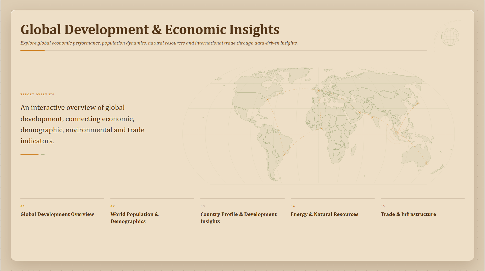
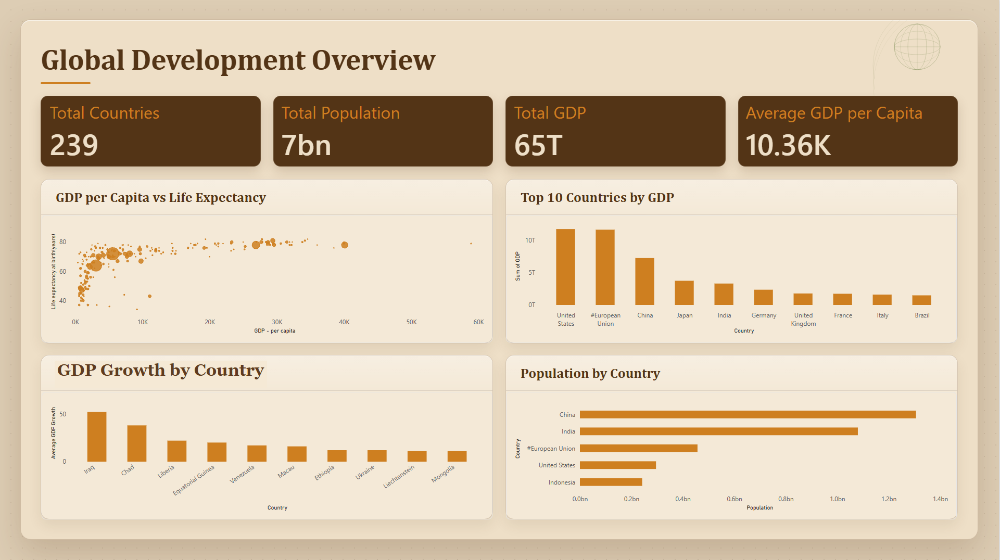
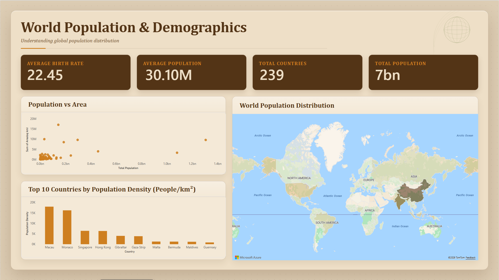
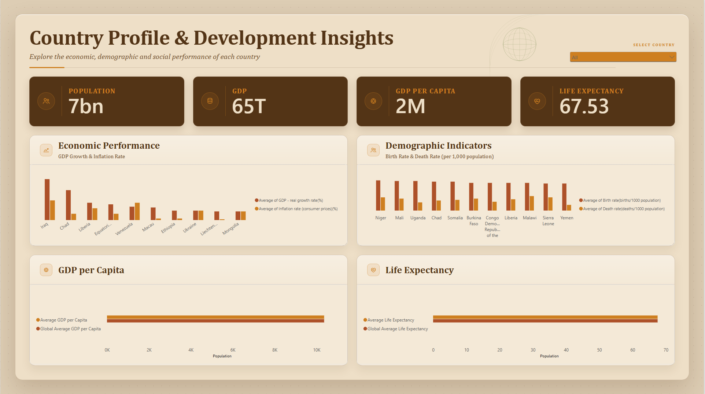
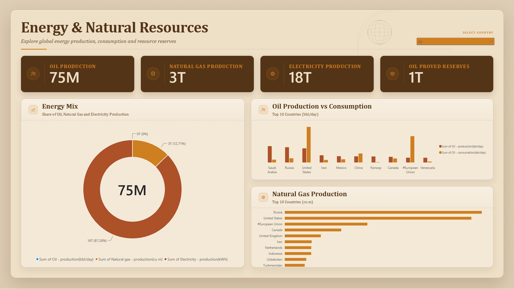

# Global Development & Economic Insights
### Advanced Power BI Dashboard & Data Modeling

An interactive Power BI report exploring global development through economic performance, population dynamics, country-level indicators, and energy resources.



## Project at a Glance

| Item | Details |
|---|---|
| Project | Mini-Project 4 — Advanced Power BI Dashboard & Data Modeling |
| Platform | Microsoft Power BI Desktop |
| Dataset | Country Data Comparison |
| Coverage shown in report | 239 countries and territories |
| Report pages shown | 5 |
| Main themes | Economy, population, country development, energy and natural resources |

## Dashboard Pages

### 1. Global Development Overview — Landing Page
The report cover introduces the dashboard and its analytical sections.

### 2. Global Development Overview
A global snapshot of economic performance and population.

**KPIs**
- Total Countries
- Total Population
- Total GDP
- Average GDP per Capita

**Visuals**
- GDP per Capita vs. Life Expectancy
- Top 10 Countries by GDP
- GDP Growth by Country
- Population by Country



### 3. World Population & Demographics
Explores population distribution, country size, and population density.

**KPIs**
- Average Birth Rate
- Average Population
- Total Countries
- Total Population

**Visuals**
- Population vs. Area
- World Population Distribution Map
- Top 10 Countries by Population Density



### 4. Country Profile & Development Insights
An interactive country-level view for exploring economic, demographic, and social indicators.

**KPIs**
- Population
- GDP
- GDP per Capita
- Life Expectancy

**Visuals**
- GDP Growth and Inflation Rate
- Birth Rate and Death Rate
- GDP per Capita
- Life Expectancy

**Interactive analysis**
- Country slicer
- Drill-through analysis




### 5. Energy & Natural Resources
Explores energy production, consumption, and resource reserves.

**KPIs**
- Oil Production
- Natural Gas Production
- Electricity Production
- Oil Proved Reserves

**Visuals**
- Energy Mix
- Oil Production vs. Consumption
- Top 10 Countries by Natural Gas Production



---

## Data Analyst Mindset

This project is approached as a business intelligence exercise, not just a collection of charts. The objective is to turn country-level data into a structured view that helps a reader compare performance, identify gaps, and decide where to investigate further.

### 1. Start with the question, not the visual

The analysis is organized around practical questions:

- **Global overview:** Which countries lead in GDP and population, and how do GDP per capita and life expectancy relate?
- **Demographics:** How is population distributed, and which countries have unusually high population density?
- **Country profile:** How does a selected country's economic and demographic performance compare with the broader global picture?
- **Energy and resources:** Where is energy produced and consumed, and which countries hold significant oil and natural gas resources?

### 2. Define the metrics before interpreting them

KPIs are selected to answer specific questions, rather than to fill dashboard space. Examples in this report include Total GDP, GDP per Capita, GDP Growth, Life Expectancy, Population Density, Oil Production, and Oil Proved Reserves.

Each metric needs to be read in context:
- **Total values** describe scale, but do not automatically indicate efficiency or prosperity.
- **Per-capita measures** help put countries of different population sizes on a more comparable basis.
- **Rates and percentages** describe intensity or change, and should not be confused with absolute totals.
- **Production and consumption** are different measures; a production figure alone does not establish a country's net energy position.

### 3. Compare, segment, and investigate

The report uses rankings, country comparisons, scatter analysis, demographic indicators, and geographic distribution to move beyond a single headline number. The country slicer and drill-through workflow support a shift from a global view to a country-level investigation.

The intent is to ask follow-up questions when a result stands out: Is the difference driven by population size, economic scale, growth, or another indicator? Does the pattern hold across other countries? Is the comparison based on a total, a rate, or a per-capita measure?

### 4. Treat data quality as part of the analysis

Country-level datasets can contain missing values and indicators measured in different units or reported on different bases. Missing values are kept blank rather than silently converted to zero. Comparisons are interpreted within the meaning and unit of each indicator.

For example, oil production, natural gas production, and electricity production use different units. Their raw values should not be added together or treated as directly comparable quantities just because they appear in the same report.

### 5. Turn findings into decision-oriented questions

The dashboard is designed to support further investigation, not to claim that correlation proves causation or that one KPI alone explains a country's development. A useful analytical outcome is a clear next question for a stakeholder, such as:

- Which countries should be examined more closely because their GDP per capita and life expectancy differ from the overall pattern?
- Which countries have high population density relative to their available area?
- How does a selected country's growth and inflation profile compare with its demographic indicators?
- Which countries are major producers of oil or natural gas, and how does oil production compare with consumption?

### 6. Communicate the insight clearly

The report follows a progression from global context to focused analysis: overview, demographics, country profile, and energy resources. KPI cards establish context, visuals reveal comparisons and patterns, and interactive filtering/drill-through allow the reader to investigate the countries behind the numbers.

**Analytical principle:** A chart is not the final answer. The value comes from defining the right question, validating the metric, understanding the comparison, explaining the limitation, and communicating what should be investigated next.

---

## Tools & Skills

- Microsoft Power BI Desktop
- Power Query
- DAX measures and calculations
- Data modeling
- KPI design
- Interactive filtering and slicers
- Drill-through
- Geographic visualization
- Data visualization and storytelling

## Dataset

The report uses the **Country Data Comparison** dataset, containing indicators related to:
- GDP and economic growth
- Population and demographics
- Health and social indicators
- Oil, natural gas, and electricity
- Infrastructure
- International trade

Missing source values are treated as blanks rather than assumed to be zero.

> **Source file note:** The original CSV was not included in the uploaded files for this package. If Power BI asks for the source when refreshing, reconnect the report to your original `Country Data Comparison.csv` file.

## How to Open

1. Download `Mini_Project.pbix`.
2. Open it using Microsoft Power BI Desktop.
3. If prompted, update the CSV source path to your local `Country Data Comparison.csv`.
4. Refresh the data if required.

## Repository Structure

```text
Global-Development-PowerBI-GitHub/
├── README.md
├── Mini_Project.pbix
└── assets/
    ├── 01-global-development-overview.png
    ├── 02-global-overview.png
    ├── 03-world-population-demographics.png
    ├── 04-country-profile-development-insights.png
    └── 05-energy-natural-resources.png
```

## Author

**Ahmed Osama**

Data Analysis | Power BI | SQL | Python
